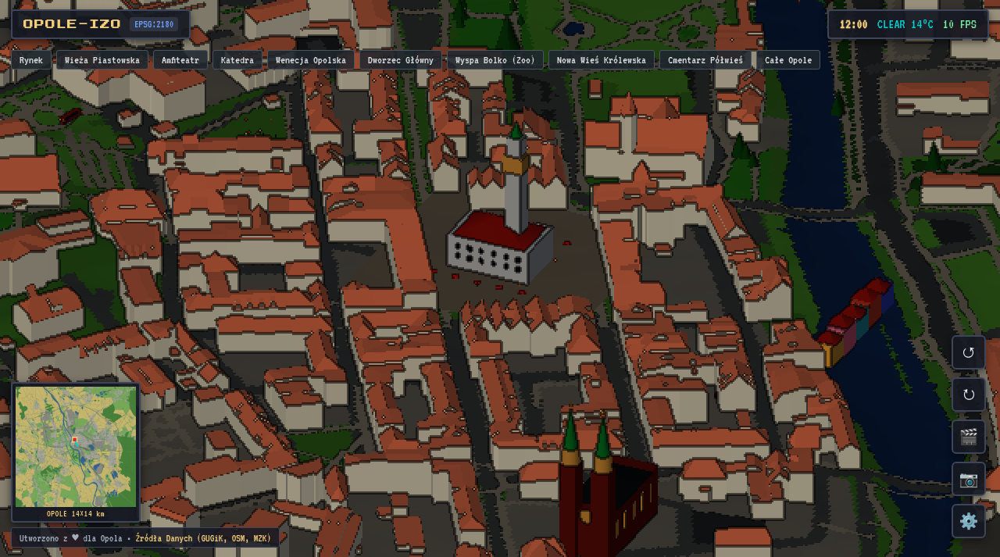

# Opole-IZO: Isometric Living-City 3D Map

A browser-based isometric pixel-art 3D living simulation of the city of **Opole, Poland**, built in strict accordance with the [`izo.md`](file:///home/lucius/Priv/AGY/Opole-IZO/izo.md) implementation specification.



---

## 🌟 Highlights

- **Full City & Surroundings (14 km × 14 km, 196 tiles):**
  - Metric Polish National Grid **EPSG:2180 (PUWG 1992)**.
  - Scene origin centered on **Opole Rynek (Ratusz)** (`E: 423960.0 m, N: 311640.0 m`).
  - Graded bare-earth DTM elevation model, riverbeds clamped to 152.5 m, bridges and tunnel portals cleanly cut.
- **Official GUGiK LoD2 CityGML Buildings:**
  - 19,336 buildings with realistic pitched and flat roof geometries extracted from official geodetic datasets (TERYT: 1661).
  - Double-sided rendering to preserve inner courtyards.
- **Hand-Crafted Signature Landmarks:**
  - **Ratusz w Opolu:** 65m Florentine Palazzo Vecchio-style clock tower, belfry, and cloth hall arcades.
  - **Rynek Tenements:** Per-house Dutch gables, colorful pastel façades, and street-level café terraces.
  - **Wieża Piastowska:** 13th-century cylindrical Gothic brick fortress tower on Wyspa Pasieka.
  - **Amfiteatr Tysiąclecia:** National Song Festival stage with the sweeping white acoustic canopy and floodlight masts.
  - **Katedra Świętego Krzyża:** 73m soaring neo-Gothic twin spires, Gothic nave, and rose window.
  - **Most Groszowy (Most Zielony):** Art Nouveau green wrought-iron pedestrian bridge across Kanał Młynówka.
  - **Opolska Wenecja:** Historic riverside houses built directly on canal stone quay retaining walls.
  - **Dworzec Główny PKP:** Historic 19th-century railway station with clock tower and covered platforms.
  - **Solaris Center:** Modern stone & glass mall fronting Plac Kopernika.
- **Living Simulation Layers:**
  - **Vehicular Traffic:** Cars, delivery vans, and motorcycles navigating road graphs, obeying speeds, and emitting twin headlight beams at night.
  - **Pedestrian Life:** Citizens strolling along sidewalk graphs with animated walking strides and café gatherings.
  - **Transit Network:** MZK Opole buses (Solaris Urbino Electric / MAN Lion's City in authentic red/yellow livery) + PKP InterCity Pendolino (ED250) and Polregio Impuls trains traversing the E30 arterial corridor.
  - **Aviation:** Aeroklub Opolski gliders circling thermal updrafts over Wyspa Bolko and Polish Air Ambulance (LPR) helicopter sorties.
  - **Dynamic Weather & Sun:** Real astronomical solar elevation based on Opole latitude (50.6668° N), volumetric pixel clouds with ground shadows, rain streaks, snow flakes, lightning, and live Open-Meteo sync.
  - **Date-Driven Easter Eggs:**
    - 1–2 Nov (Wszystkich Świętych): Sea of flickering candlelight across Cmentarz Komunalny w Półwsi.
    - 6 Dec – 12 Jan: Festive Christmas tree with fairy lights and holiday stalls on Rynek.
    - 31 Dec 23:50 – 1 Jan 00:10: New Year fireworks bursting above Rynek and Odra.
    - Summer (May–Sept): Cows, horses, and sheep grazing on Odra riverbank meadows.
- **Pixel-Art Aesthetics & Post-Processing:**
  - Render target at ½ CSS resolution with custom crease/outline WebGL pass for crisp outlines.
  - Nearest-neighbour upscale with optional **Timothy Lottes CRT shader** (aperture grille, scanlines, phosphor bloom).
- **Web Worker Streaming:**
  - Binary tile files (`.bin`) decoded in background Web Workers with zero-copy transferable buffers, budgeted at one commit per frame for rock-solid 60 FPS.
- **Caching Reverse Proxy:**
  - Node.js proxy at `/api/*` (12s cache for live MZK transit, 10 min for weather) protecting external servers with strict CSP (`connect-src 'self'`).

---

## 🚀 Quick Start

### 1. Launch the Server
To run the precomputed application right away:
```bash
./start.sh
```
Open **[http://localhost:3000](http://localhost:3000)** in your browser.

### 2. Re-run Pipeline (Optional)
To re-process open data from scratch:
```bash
./run_all.sh
```

---

## 🎮 Controls & Shortcuts

| Action | Control |
|---|---|
| **Pan Map** | Left Mouse Drag / Arrow Keys / Touch Drag |
| **Rotate View** | Right Mouse Drag / `A` / `D` (or `Q` / `E`) |
| **Snap 45°** | Click `↺` / `↻` buttons |
| **Zoom** | Mouse Scroll Wheel / Touch Pinch |
| **POI Quick Jump** | Click any button in the top ribbon (Rynek, Katedra, Amfiteatr, etc.) |
| **Screensaver Tour** | Click `🎬` or press `T` |
| **Clean Screenshot** | Click `📷` or press `P` (captures canvas without HUD) |
| **Toggle Control Drawer** | Click `⚙️` or press `U` |
| **Copy Link to View** | Click **"Kopiuj Link do Widoku"** (all settings encoded in URL hash) |

---

## 📁 Repository Structure

```
Opole-IZO/
├── pipeline/                     # Python 3.12 data processing pipeline
│   ├── venv/                     # Isolated virtual environment
│   ├── config.py                 # Bounds, origin (EPSG:2180), extent config
│   ├── palette.py                # 64-class palette x 4 seasons
│   ├── 01_download.py            # LoD2 CityGML & OSM extract fetcher
│   ├── 02_terrain.py             # DTM elevation model & CHM
│   ├── 03_osm_extract.py         # Fast PyOsmium extraction -> osm.pkl
│   ├── 04_grade.py               # Bare-earth DTM grading (water, bridges, tunnels)
│   ├── 05_buildings.py           # LoD2 CityGML parser & landmark exclusion
│   ├── 06_trees.py               # Tree distribution from landuse & DTM
│   ├── 07_traffic_graph.py       # Road network, speeds, traffic signals
│   ├── 08_walk_graph.py          # Sidewalks, pedestrian paths, plazas
│   ├── 09_transit.py             # MZK bus routes & E30 railway paths
│   └── 10_tile_generator.py      # Binary tile meshes (.bin) & indexed PNGs
├── data/
│   ├── raw/                      # Downloaded source geodata
│   └── build/                    # Intermediate arrays and pickles
├── server/
│   └── proxy.js                  # Caching reverse proxy & static file server
├── web/                          # Frontend Vite + Three.js application
│   ├── public/data/              # Static tiles, manifest, and simulation graphs
│   ├── src/
│   │   ├── core/                 # Camera, renderer, tile manager
│   │   ├── workers/              # Web Worker tile decoder
│   │   ├── environment/          # Astronomical sun, sky, clouds, rain, snow
│   │   ├── landmarks/            # Hand-modelled 3D landmarks of Opole
│   │   ├── simulation/           # Traffic, pedestrians, transit, aviation, easter eggs
│   │   ├── ui/                   # Control drawer, POI tour, screenshot
│   │   ├── style.css             # Retro pixel-art HUD stylesheet
│   │   └── main.js               # Application orchestrator
│   └── package.json
├── run_all.sh                    # Full pipeline runner script
├── start.sh                      # Application launch script
├── izo.md                        # Master architectural specification
└── README.md
```

---

## 📜 Credits & Open Data Attribution

- **GUGiK (Główny Urząd Geodezji i Kartografii):** Modele 3D budynków LoD2 (PZGiK, licencja CC BY 4.0), NMT & NMPT.
- **OpenStreetMap:** Sieć drogowa, rzeka Odra, kanał Młynówka, tereny zielone, POI (© OpenStreetMap contributors, ODbL).
- **MZK Opole / zbiorkom.live:** Dynamiczny rozkład jazdy i pozycje GPS autobusów (GTFS-RT).
- **Open-Meteo:** Dane meteorologiczne na żywo (CC BY 4.0).
